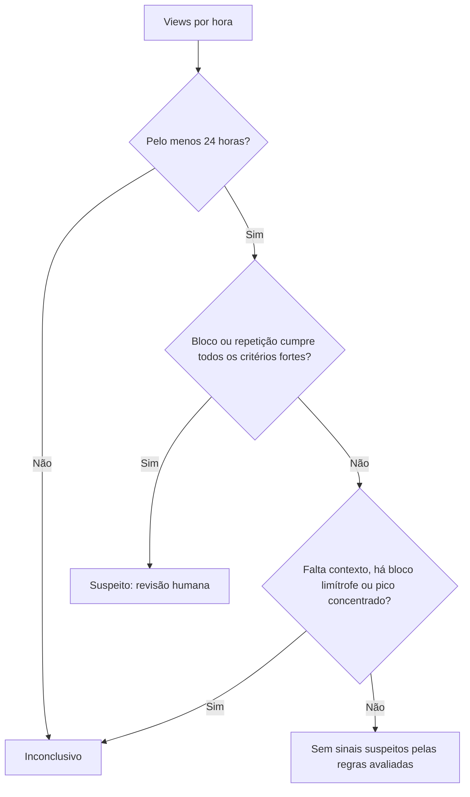

# Desafio 9 · Views que não parecem humanas

**Classificação explicável de views por hora · API HTTP · TypeScript · Regras 1.1.0**

Uma marca precisa avaliar alcance sem punir um criador por uma viralização real. Esta API procura padrões temporais mecânicos e devolve a decisão, um motivo legível e as medidas que a sustentam.

> **Suspeita recomenda revisão humana.** A série horária sozinha não prova compra de views e não deve bloquear pagamentos automaticamente.

[Executar](#executar) · [Decisões](#como-a-decisão-é-tomada) · [API](#api) · [Dataset](#dataset-reproduzível) · [Resultados](#resultados-medidos) · [Limites](#limites) · [Testes](#testes) · [Uso de IA](#uso-de-ia-e-revisão)

## Executar

Requisito: **Node.js 20 ou superior**.

```bash
npm ci
npm run dev
```

| Endpoint | Função |
|---|---|
| `GET http://localhost:3000/health` | Verificar disponibilidade |
| `POST http://localhost:3000/classify` | Classificar views ganhas por hora |

O servidor aceita a variável `PORT`. `npm start` executa sem observar alterações nos arquivos.

Para gerar os datasets, calcular as taxas e atualizar este README em **um comando**:

```bash
npm run evaluate -- --update-readme
```

## Como a decisão é tomada

| Resposta | Significado | Próximo passo |
|---|---|---|
| `suspeito` | Um bloco mecânico ou uma repetição cumpriu todos os critérios fortes | Revisão humana |
| `inconclusivo` | Faltam observações, há um bloco limítrofe ou a origem de um pico é ambígua | Obter contexto temporal ou revisar a origem |
| `sem_sinais_suspeitos` | Nenhuma janela cumpriu as regras de suspeita ou abstenção | Nenhuma ação automática; autenticidade não está comprovada |



### Padrões, visualmente

Os desenhos são esquemáticos. As séries exatas e os resultados esperados estão nos testes.

| Forma | Série ilustrativa | Comportamento |
|---|---|---|
| Viralização suave | `▁▁▂▄▆█▆▄▂▁▁` | Pode passar sem suspeita, mesmo com grande alcance |
| Bloco muito regular | `▁▁████████████▁▁` | Suspeito quando atende a todos os limites, inclusive com mais de 24h |
| Pulsos mecânicos | `▁█▁▁█▁▁█▁▁█▁` | Suspeito quando quatro ciclos têm forma quase idêntica |
| Pico isolado | `▁▁▁▁█▁▁▁▁▁▁` | Inconclusivo se muito concentrado; pode ser orgânico |
| Bloco ainda em andamento | `▁▁████████████→` | Inconclusivo se falta observar seu término |

### Critérios auditáveis

**Bloco elevado:** todos os critérios abaixo precisam ser satisfeitos simultaneamente.

| Medida | Limite para suspeita |
|---|---|
| Duração | Pelo menos 8 horas; sem teto próprio de 24h, respeitando a entrada de até 720h |
| Média | Pelo menos 100 views/hora |
| Variação relativa | Desvio padrão / média de até 2% |
| Elevação sobre o fundo | Pelo menos 10× a maior mediana dos contextos anterior e posterior |
| Subida e queda | Pelo menos 5× entre as horas imediatamente antes/depois das bordas |
| Contexto | Pelo menos 4 horas observadas antes e 4 depois |

O bloco é avaliado como um episódio inteiro entre bordas abruptas. Isso evita perder uma compra constante de 25, 48 ou mais horas. A variância é calculada de forma incremental para evitar perda de precisão por subtração de números grandes.

**Faixa de abstenção:** blocos com média, elevação e bordas suficientes, mas duração de 4–7h ou variação acima de 2% e até 5%, ficam inconclusivos. Um bloco de pelo menos 4h com variação de até 5%, uma borda abrupta e elevação suficiente também fica inconclusivo se falta contexto em uma borda. Casos próximos dos limites recomendam revisão humana; contexto temporal faltante recomenda obter o trecho ausente.

**Repetição:** quatro ciclos consecutivos de período entre 2 e 12h, amplitude de pelo menos 100 views/hora, contraste de pelo menos 10× e erro normalizado de até 2%. O erro é a raiz da média dos desvios quadráticos em relação ao ciclo médio, dividida pela amplitude. O contraste usa `(máximo + 1) / (mínimo + 1)`.

**Pico ambíguo:** nas janelas locais de 24h, as três maiores horas precisam somar pelo menos 60% das views e o pico precisa ser pelo menos 10× a mediana local. As janelas são centradas em máximos locais, com 12h anteriores e 11 posteriores quando disponíveis; nas bordas, são deslocadas para caber na série. Assim, a subida de uma curva suave não vira um falso pico isolado, e acrescentar horas normais distantes não dilui um evento já observado com contexto completo. A origem requer revisão humana, pois mais horas de contagem sozinhas podem não esclarecê-la.

Uma evidência forte de bloco ou repetição tem prioridade sobre os motivos de abstenção. Sem evidência forte, a prioridade é: contexto faltante, bloco limítrofe e pico ambíguo.

## API

Envie **views ganhas em cada hora**, em horas consecutivas. Valores acumulados e lacunas de coleta precisam ser tratados antes da chamada.

```http
POST /classify
Content-Type: application/json

{"views":[100,135,210,180]}
```

```json
{
  "classification": "inconclusivo",
  "reason": "A série tem 4 horas; são necessárias pelo menos 24 para avaliar os padrões temporais.",
  "signals": [
    {
      "code": "series.hours",
      "value": 4,
      "unit": "hours",
      "threshold": 24,
      "comparison": ">=",
      "triggered": false
    }
  ],
  "recommendedAction": "obter_mais_dados",
  "ruleVersion": "1.1.0"
}
```

| Campo da resposta | Como interpretar |
|---|---|
| `classification` | Uma das três decisões da tabela acima |
| `reason` | Motivo em português, com horas e valores relevantes |
| `signals` | Código, valor medido, unidade, limiar e comparação de cada condição reportada |
| `signals[].triggered` | A condição individual foi satisfeita; uma condição sozinha não determina suspeita |
| `signals[].window` | Horas inicial e final inclusivas, começando em **1** |
| `recommendedAction` | `nenhuma`, `obter_mais_dados` ou `revisao_humana` |
| `ruleVersion` | Versão dos critérios usados; permite auditar mudanças de decisão |

Quando um bloco candidato tem variação acima de 5% e até 15%, a resposta sem suspeita informa a variação que o descartou. Repetições próximas dos critérios, com erro acima de 2% e até 10%, também podem aparecer como diagnóstico. Esses limites de diagnóstico não geram suspeita. A resposta apresenta a evidência decisiva ou candidatos relevantes, e não todas as janelas examinadas.

A entrada aceita entre **1 e 720 inteiros seguros não negativos**, com soma também segura. Menos de 24 horas gera abstenção. Campos desconhecidos, frações, strings, números negativos e somas inseguras retornam **400**. Corpo acima de 256 KiB retorna **413**; tipo de conteúdo não suportado, **415**; falha interna, **500** sem expor detalhes privados.

<details>
<summary>Mudanças da regra 1.0.0 para 1.1.0</summary>

- Blocos acima de 24h passam a ser avaliados integralmente.
- Blocos curtos e próximos do limite de variação ganham abstenção explícita.
- Os sinais incluem duração, contexto disponível e a janela local dos picos.
- Resultados sem suspeita explicam candidatos descartados quando disponíveis.
- Picos ambíguos recomendam revisão da origem; séries curtas ou sem contexto temporal recomendam obter mais dados.
- O corpo da requisição e os campos principais da resposta permanecem compatíveis. Consumidores devem considerar a nova versão das regras ao comparar decisões e sinais.

</details>

## Dataset reproduzível

| Conjunto | Seed | Legítimas | Artificiais | Casos ambíguos adicionais |
|---|---:|---:|---:|---:|
| Desenvolvimento | `20260901` | 1.300 | 1.100 | 4 |
| Holdout | `20261009` | 1.300 | 1.100 | 4 |

Cada conjunto preserva os 1.500 exemplos originais e acrescenta **900 cenários de estresse**. O gerador é local, determinístico e não importa os limiares do classificador nem depende de redes sociais reais.

| Cenários originais | Cenários adicionais |
|---|---|
| Crescimento gradual, viralização, ondas, divulgação externa e volume irregular | Campanhas autorizadas longas, picos orgânicos curtos e sazonalidade diária |
| Blocos mecânicos, pulsos repetidos, pico comprado e crescimento disfarçado | Blocos longos, curtos, ruidosos ou sem contexto; pulsos ruidosos ou de período fora da faixa |

Entre os exemplos originais de divulgação externa, cada um tem 15% de chance de representar uma campanha autorizada regular. Os cenários adicionais incluem episódios de até 672h, séries de até 720h, pulsos com 3–6 ciclos e períodos de até 24h. Picos orgânicos curtos usam a mesma distribuição observável dos picos comprados: o rótulo sintético conhece a origem, mas a API não recebe essa informação.

O holdout muda a seed, mantendo os mesmos mecanismos geradores. Ele verifica novas amostras da simulação, **não comprova generalização para tráfego real**. A composição ampliada impede comparar diretamente as taxas agregadas atuais com as antigas.

## Resultados medidos

```text
FPR       = legítimas classificadas como suspeitas / todas as legítimas
Detecção  = artificiais classificadas como suspeitas / todas as artificiais
Abstenção = séries inconclusivas / total de séries da respectiva origem
```

Inconclusivos permanecem nos denominadores: não contam como falso positivo nem como detecção. As taxas descrevem somente esta simulação e suas proporções. A meta inicial de FPR de até 2% é uma referência de desenvolvimento, não uma garantia; o resultado medido é publicado mesmo quando supera essa meta.

O bloco abaixo é gerado por `npm run evaluate -- --update-readme`. O teste recalcula os valores e falha quando o README ou o relatório diverge.

<!-- EVALUATION:START -->
Regras avaliadas: **1.1.0**. Resultado calculado pelo comando `npm run evaluate`; as taxas abaixo vêm dos exemplos sintéticos identificados por seed.

| Conjunto | Seed | Falsos positivos / legítimas | FPR | Detectadas / artificiais | Detecção |
|---|---:|---:|---:|---:|---:|
| Desenvolvimento | 20260901 | 33/1300 | 2.54% | 474/1100 | 43.09% |
| Holdout | 20261009 | 32/1300 | 2.46% | 476/1100 | 43.27% |

**FPR no holdout:** 32/1300 = 2.46%. **Detecção artificial:** 476/1100 = 43.27%. Inconclusivos não contam como falso positivo nem como detecção.

| Conjunto | Legítimas inconclusivas | Artificiais inconclusivas | Abstenções esperadas em casos ambíguos |
|---|---:|---:|---:|
| Desenvolvimento | 155/1300 (11.92%) | 505/1100 (45.91%) | 4/4 |
| Holdout | 158/1300 (12.15%) | 504/1100 (45.82%) | 4/4 |

Casos de origem ambígua ficam fora das taxas binárias por não terem rótulo único de origem. Artificiais não detectados incluem os inconclusivos e os classificados sem sinais suspeitos.

**Holdout por família** — a FPR de um grupo pode ser muito maior que a taxa geral:

| Família | Origem sintética | Séries | Suspeitas | Inconclusivas | FPR do grupo | Detecção do grupo |
|---|---|---:|---:|---:|---:|---:|
| crescimento_gradual | Legítima | 200 | 0 | 0 | 0.00% | — |
| viralizacao_explosiva | Legítima | 200 | 0 | 0 | 0.00% | — |
| ondas_organicas | Legítima | 200 | 0 | 0 | 0.00% | — |
| divulgacao_externa | Legítima | 165 | 0 | 0 | 0.00% | — |
| campanha_autorizada_regular | Legítima | 35 | 14 | 16 | 40.00% | — |
| baixo_volume_irregular | Legítima | 200 | 0 | 0 | 0.00% | — |
| bloco_mecanico | Artificial | 200 | 200 | 0 | — | 100.00% |
| pulsos_repetidos | Artificial | 150 | 150 | 0 | — | 100.00% |
| pico_isolado | Artificial | 100 | 0 | 100 | — | 0.00% |
| crescimento_disfarcado | Artificial | 50 | 0 | 0 | — | 0.00% |
| campanha_longa_autorizada | Legítima | 100 | 18 | 42 | 18.00% | — |
| pico_organico_curto | Legítima | 100 | 0 | 100 | 0.00% | — |
| sazonalidade_diaria | Legítima | 100 | 0 | 0 | 0.00% | — |
| bloco_longo | Artificial | 100 | 100 | 0 | — | 100.00% |
| bloco_curto | Artificial | 100 | 0 | 100 | — | 0.00% |
| bloco_ruidoso | Artificial | 100 | 2 | 34 | — | 2.00% |
| bloco_sem_contexto | Artificial | 100 | 0 | 100 | — | 0.00% |
| pulsos_fora_faixa | Artificial | 100 | 0 | 100 | — | 0.00% |
| pulsos_ruidosos | Artificial | 100 | 24 | 70 | — | 24.00% |

Exemplos de falsos positivos: legitimate-campanha_autorizada_regular-003 (campanha_autorizada_regular), legitimate-campanha_autorizada_regular-009 (campanha_autorizada_regular), legitimate-campanha_autorizada_regular-013 (campanha_autorizada_regular), legitimate-campanha_autorizada_regular-030 (campanha_autorizada_regular), legitimate-campanha_autorizada_regular-039 (campanha_autorizada_regular). Exemplos de artificiais não detectados: artificial-pico_isolado-001 (pico_isolado), artificial-pico_isolado-002 (pico_isolado), artificial-pico_isolado-003 (pico_isolado), artificial-pico_isolado-004 (pico_isolado), artificial-pico_isolado-005 (pico_isolado). Os detalhes completos estão em `reports/evaluation.json`.
<!-- EVALUATION:END -->

## Limites

| Situação | Limitação e cuidado necessário |
|---|---|
| Campanha legítima com tráfego muito regular | Pode compartilhar todos os sinais de compra. Consulte a **FPR por família**, não apenas a geral |
| Compra gradual ou que imita variação orgânica | Pode passar sem sinais; essa resposta não certifica autenticidade |
| Bloco com variação acima de 5% | Pode ficar sem suspeita; até 15% pode aparecer como candidato descartado na explicação |
| Pulsos com menos de quatro ciclos ou período acima de 12h | Fora da regra de repetição; alguns ainda geram abstenção pela concentração local |
| Série inteira em nível alto, sem fundo observado | Não há referência suficiente para estabelecer elevação; constância sozinha não prova compra |
| Origens diferentes produzindo a mesma série | A API devolve a mesma resposta. São necessários dados de origem, audiência ou engajamento |
| Lacunas, contagens acumuladas ou erros de coleta | A API valida valores, mas não identifica a semântica incorreta dos dados |

Os falsos positivos das campanhas autorizadas continuam visíveis no relatório. Os critérios fortes não foram afrouxados para melhorar artificialmente a detecção, e o dataset não foi filtrado para esconder erros. A faixa de abstenção reduz conclusões precipitadas em casos limítrofes, mas não resolve a ambiguidade de origem dos blocos muito regulares.

## Testes

```bash
npm test
npm run typecheck
npm run build
```

| Verificação | O que protege |
|---|---|
| Curva orgânica × bloco mecânico com alcance e pico semelhantes | O volume sozinho não decide a classificação |
| Blocos de 8, 24, 25, 48, 168 e 672 horas | A duração adicional não elimina a detecção |
| Blocos de 4–7h, variação de 2%, 2,1%, 3%, 5% e 6% | Suspeita, abstenção e descarte têm fronteiras explícitas |
| Contexto faltante antes/depois de um bloco longo | O coletor não confirma uma borda que não observou |
| Pico em 72h e em 720h, com horas normais antes ou depois | A abstenção local resiste à extensão da série |
| Casos óbvios em todas as seeds | Regenerar o README não encobre regressões de detecção e proteção orgânica |
| Seeds, entradas e arquivos regenerados | O dataset é reproduzível e pode ser enviado à API |
| README e relatório contra métricas recalculadas | A FPR publicada vem do código; um cenário altera somente a FPR e verifica a falha |
| Validação HTTP e erros 400/413/415/500 | Erros de entrada não são aceitos silenciosamente nem expõem detalhes internos |

### Arquivos da entrega

| Caminho | Conteúdo |
|---|---|
| [`src/classifier.ts`](src/classifier.ts) | Regras, sinais, motivos e versão |
| [`src/app.ts`](src/app.ts) | API e validação HTTP |
| [`src/dataset/generator.ts`](src/dataset/generator.ts) | Gerador sintético determinístico |
| [`src/evaluation.ts`](src/evaluation.ts) | Métricas e renderização do bloco publicado |
| [`data/`](data/) | Datasets de desenvolvimento e holdout |
| [`reports/evaluation.json`](reports/evaluation.json) | Contagens por família e exemplos de erros |
| [`test/`](test/) | Casos funcionais, regressões e consistência da avaliação |

Para gerar somente os datasets, use `npm run generate:dataset`. `npm run evaluate` gera os datasets e o relatório e imprime as taxas; acrescente `-- --update-readme` para sincronizar o bloco publicado.

## Uso de IA e revisão

**Feito com IA:** o Codex escreveu a API, as regras, o gerador, a avaliação, os testes e a documentação originais. Conforme o registro anterior desta entrega, houve revisão técnica em outra sessão de IA, incluindo o tratamento de erros HTTP.

**Revisado nesta iteração, também com IA:** comportamento dos limites, blocos acima de 24h, abstenção, dependência do tamanho da série, explicações dos candidatos descartados, composição do dataset, métricas por família e coerência entre documentação e implementação. O Codex implementou as correções e os cenários adicionais e executou testes, checagem de tipos e build. Esta revisão não equivale a uma validação externa com dados reais.

**Participação humana declarada:** filtrar prompt injections, definir escopo e checkpoints, acompanhar evidências e solicitar a comparação entre viralização plausível, padrões mecânicos e casos inconclusivos. Nesta iteração, o usuário solicitou a análise crítica, as melhorias e a atualização visual do README. A escrita do código e a execução automatizada dos testes foram feitas com IA; não se declara revisão humana de cada linha.
